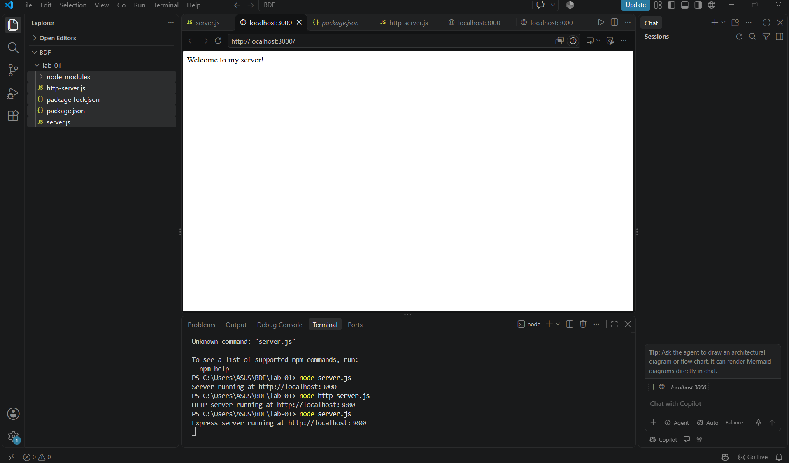
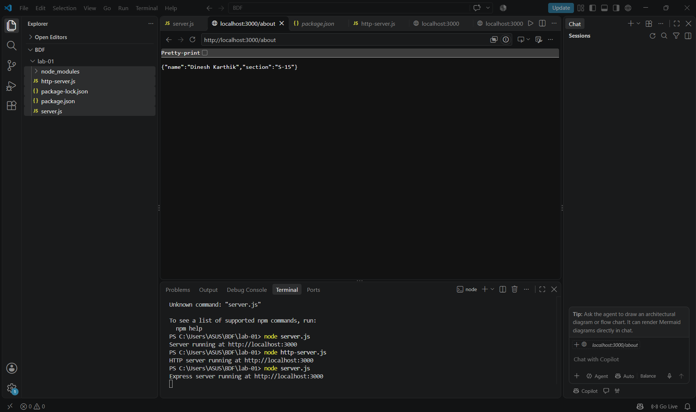
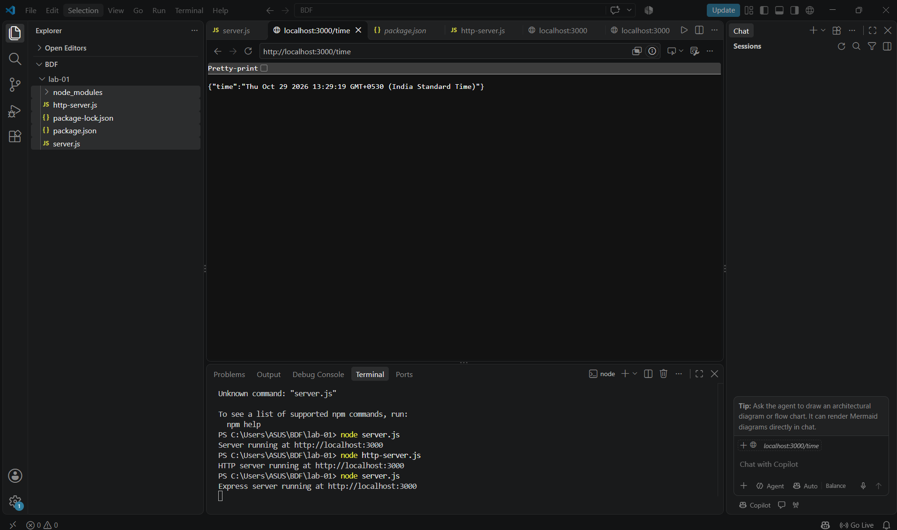

# Lab 1: Node.js and Express Server

## Student Details

- **Name:** Dinesh Karthik
- **Registration Number:** 252U1R1023
- **Section:** S-15
- **Course:** Backend Development Fundamentals
- **Institution:** Aurora demeed to be University

## Objective

To understand Node.js and Express.js fundamentals by creating a basic HTTP server using Node.js and building a web server using Express.js with multiple routes.

## Technologies Used

- Node.js
- Express.js
- JavaScript
- NPM
- Git and GitHub

## Project Structure

BDF
lab-01/
│
├── screenshots/
│   ├── home.png
│   ├── about.png
│   └── time.png
│
├── server.js
├── http-server.js
├── package.json
├── package-lock.json
├── .gitignore
└── README.md


## Installation and Setup

### 1. Install Node.js

Download and install Node.js from:

https://nodejs.org/

### 2. Clone the repository

```bash
git clone YOUR_GITHUB_REPOSITORY_URL
```

### 3. Navigate to the project folder

```bash
C:\Users\ASUS\BDF\lab-01>
```

### 4. Install dependencies

```bash
npm install
```

### 5. Start the Express server

```bash
node server.js
```

The server will run at:

http://localhost:3000

## HTTP Server

A basic HTTP server was created using Node.js built-in `http` module.

**Command:**

```bash
node http-server.js
```

It responds with:

```text
Hello
```

## Express Server Endpoints

The following routes were implemented using Express.js.

| Method | Endpoint | Description | Status Code |
|---|---|---|---|
| GET | `/` | Displays welcome message | 200 |
| GET | `/about` | Displays name and section in JSON | 200 |
| GET | `/time` | Displays current date and time | 200 |
| GET | Any unknown route | Displays 404 Not Found | 404 |

## Screenshots

### 1. Home Page



### 2. About Page



### 3. Time Page



### 4. 404 Error Page


## Live Deployment

**Live URL:** https://bdf-dineshkarthik-lab1.onrender.com/
## GIT CLONE **https://github.com/dinnudk07-sudo/Dinesh-Karthik.git**
## What I Learned

- Understanding Node.js fundamentals.
- Creating a project using `npm init`.
- Understanding the purpose of `package.json` and `node_modules`.
- Installing and using Express.js.
- Creating an HTTP server using the built-in `http` module.
- Creating routes using Express.js.
- Handling GET requests and sending JSON responses.
- Handling unknown routes using 404 status codes.
- Testing server endpoints in a web browser.
- Uploading projects to GitHub.

## Viva Questions

**1. What is Node.js?**

Node.js is a JavaScript runtime environment that allows JavaScript to run outside the browser.

**2. What is Express.js?**

Express.js is a web framework for Node.js used to build web servers and APIs easily.

**3. What is package.json?**

It is a file that stores project information, scripts and dependencies.

**4. What is node_modules?**

It is the folder that contains installed project dependencies.

**5. What does app.listen() do?**

It starts the Express server and listens for incoming requests on a specified port.

**6. What are request and response?**

Request represents the incoming client request, and response represents the server's reply.

## Conclusion

Successfully created a basic HTTP server using Node.js and an Express server with multiple GET routes. Tested all endpoints and implemented 404 error handling.

---

**Submitted by: Dinesh Karthik**